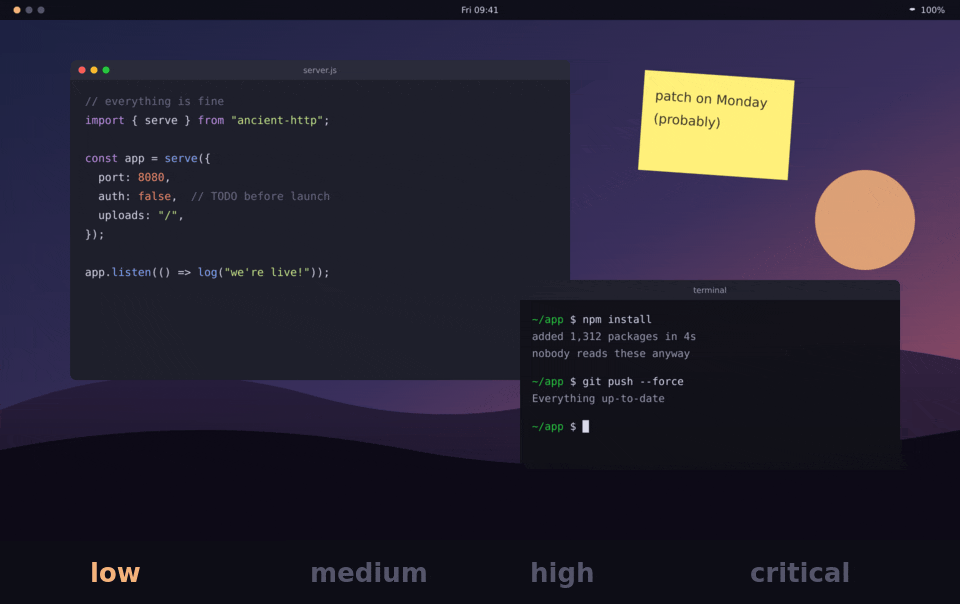

# CVEsmic



**Your screen shakes when the internet catches fire.**

CVEsmic watches the [pwn.watch](https://pwn.watch/) feed. When a new vulnerability lands, your whole desktop gives a little jolt. A low-severity item gets a nudge, and a critical one gets a three-second quake. You feel it before you read about it.

When the shaking stops, the news follows, the way people post after an earthquake. A notification names each new item and its severity, and a click on it opens the item on pwn.watch.

It is an alarm bell, not an encyclopaedia. It follows one feed, pwn.watch's "Patch now" feed by default. It won't tell you whether an item affects you.

## What you need

- On GNOME, GNOME Shell 48, 49 or 50 under Wayland. CVEsmic is a shell extension there and needs nothing else.
- Anywhere else, [Quickshell](https://quickshell.org/), on a Wayland compositor that lets it capture the screen, such as niri, Hyprland or Sway, or on KDE Plasma. CVEsmic runs as a plugin of [Dux Modular Shell](https://github.com/duxlabs-dev/dux-shell) (`dms`), or on Quickshell alone.
- On Quickshell alone, `notify-send` from libnotify and a notification daemon, for the notifications. Dux Modular Shell brings its own.
- Under Quickshell, `xdg-open`, to open an item's page from its notification.

## Installing

Every release carries one package per desktop and a `SHA256SUMS` file to check them against. The links below fetch the latest release.

On GNOME, install the extension zip, log out and back in, and switch it on:

```sh
curl -LO https://github.com/CodeForBreakfast/cvesmic/releases/latest/download/cvesmic@codeforbreakfast.co.shell-extension.zip
gnome-extensions install cvesmic@codeforbreakfast.co.shell-extension.zip
gnome-extensions enable cvesmic@codeforbreakfast.co
```

With Dux Modular Shell, unpack the Quickshell build into the shell's plugins folder, then switch it on:

```sh
curl -LO https://github.com/CodeForBreakfast/cvesmic/releases/latest/download/cvesmic-quickshell.tar.gz
mkdir -p ~/.config/dms/plugins
tar -xzf cvesmic-quickshell.tar.gz -C ~/.config/dms/plugins
dms ipc call plugins enable cvesmic
```

On Quickshell alone, unpack the same file into Quickshell's config folder and start it:

```sh
curl -LO https://github.com/CodeForBreakfast/cvesmic/releases/latest/download/cvesmic-quickshell.tar.gz
mkdir -p ~/.config/quickshell
tar -xzf cvesmic-quickshell.tar.gz -C ~/.config/quickshell
qs -c cvesmic
```

To start it with your session, have your compositor run `qs -c cvesmic` at startup.

On KDE Plasma, unpack the Quickshell build into Quickshell's config folder, install the KWin effect, and let Plasma start `qs` with your session:

```sh
curl -LO https://github.com/CodeForBreakfast/cvesmic/releases/latest/download/cvesmic-quickshell.tar.gz
curl -LO https://github.com/CodeForBreakfast/cvesmic/releases/latest/download/cvesmic-kwin.tar.gz
mkdir -p ~/.config/quickshell
tar -xzf cvesmic-quickshell.tar.gz -C ~/.config/quickshell
kpackagetool6 --type KWin/Effect --install cvesmic-kwin.tar.gz
cat > ~/.config/autostart/cvesmic.desktop <<'EOF'
[Desktop Entry]
Type=Application
Name=CVEsmic
Exec=qs -c cvesmic
EOF
```

The effect does not need switching on under System Settings. CVEsmic loads it when it needs it.

Then wait for the next bad day on the internet. It is rarely a long wait.

## How it behaves

- **It checks every five minutes.** After a failure it waits twice as long before the next try, up to an hour.
- **It doesn't panic on day one.** The first poll of a feed records the items already in it and shakes nothing. After that, any item whose id it has not seen makes the screen shake. Several new items in one poll give one shake, at the strongest severity among them.
- **Severity sets the strength.** It reads the item's tags. An item tagged `critical` shakes hardest, then `high`, `medium` and `low`. An item without one of those tags shakes as `low`.
- **The news follows the shake.** When a shake ends, each new item gets its own notification, with its title and severity. A click on the notification opens the item's page. One poll notifies about five items at most. An item whose shake was skipped still gets its notification.
- **Your work carries on.** On GNOME, the shake moves the desktop itself. On KDE Plasma, it moves the windows themselves. Under Quickshell elsewhere, it freezes a picture of the screen and shakes the picture, and clicks pass through to your apps underneath. The picture stays in memory and is dropped when the shake ends.
- **It never shakes a locked screen.** A lock that starts during a shake stops it.
- **It stays still while you share your screen on GNOME.** CVEsmic does not shake while a screen cast or a remote desktop session runs, and one that starts during a shake stops it. A cast already running when the extension is switched on goes unseen.
- **It respects what you hide from screen casts under Quickshell.** During a cast, the frozen picture hides whatever the compositor hides from the cast, such as a password manager you have blocked from screen sharing. On niri, CVEsmic does not shake at all while a cast runs, and a cast that starts during a shake stops it.

## Settings

There is one setting, the feed address. Any JSON Feed whose items carry an `id` and severity tags will work. Changing the address counts as a first poll of the new feed.

On GNOME, set it with `gsettings`, pointing it at the extension's schema:

```sh
GSETTINGS_SCHEMA_DIR=~/.local/share/gnome-shell/extensions/cvesmic@codeforbreakfast.co/schemas \
  gsettings set org.gnome.shell.extensions.cvesmic feed-url https://example.org/feed.json
```

Under Dux Modular Shell, the plugin's settings page holds the address. On Quickshell alone, set `CVESMIC_FEED_URL` in the environment that starts `qs`.

Two calls help when you want to check it works without waiting for a disaster. On GNOME they go over D-Bus:

```sh
gdbus call --session --dest org.gnome.Shell --object-path /co/codeforbreakfast/CVEsmic --method co.codeforbreakfast.CVEsmic.Poll     # poll the feed now
gdbus call --session --dest org.gnome.Shell --object-path /co/codeforbreakfast/CVEsmic --method co.codeforbreakfast.CVEsmic.Status   # what the last poll or shake did
```

Under Dux Modular Shell, the same calls go through `dms`:

```sh
dms ipc call cvesmic poll
dms ipc call cvesmic status
```

On Quickshell alone, through `qs`:

```sh
qs -c cvesmic ipc call cvesmic poll
qs -c cvesmic ipc call cvesmic status
```

## Developing

The feed logic lives in `plugin/cvesmic/Feed.mjs` and the shake's motion in `plugin/cvesmic/Shake.mjs`. Both the Quickshell build and the GNOME extension in `gnome/` import them. The tracking of niri's screen casts lives in `plugin/cvesmic/Casts.mjs`, and the KWin effect in `plugin/cvesmic/kwin`. Their tests run with Node:

```sh
node --test
```

The animation at the top is rendered, not recorded. A script shakes a staged desktop with the plugin's own shake code at each severity. Run it again after changing the shake or the strengths:

```sh
nix shell nixpkgs#nodejs nixpkgs#imagemagick nixpkgs#gifski -c node docs/render-shake.mjs
```

## Security

To report a vulnerability in CVEsmic privately, see [SECURITY.md](SECURITY.md).

## Licence

CVEsmic is released under the [MIT licence](LICENSE).
